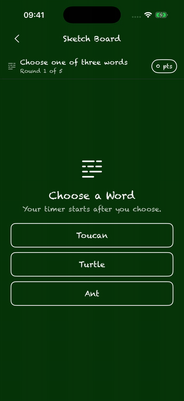
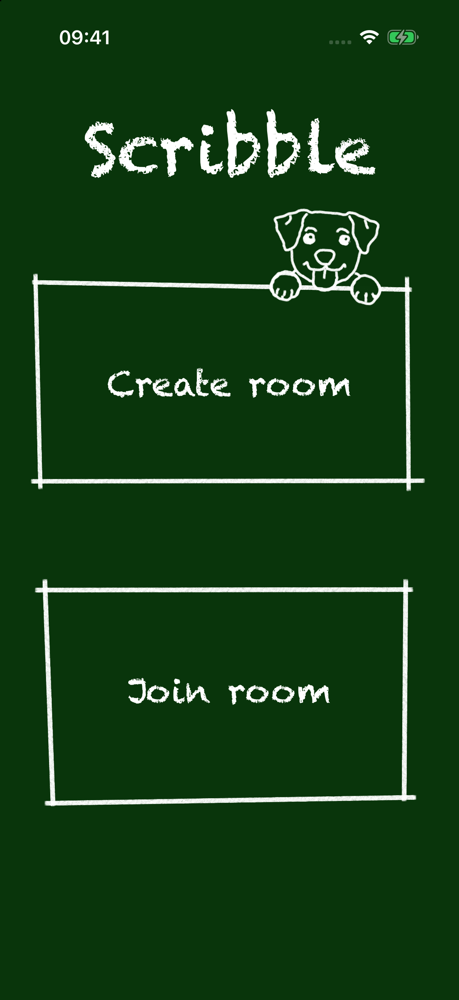
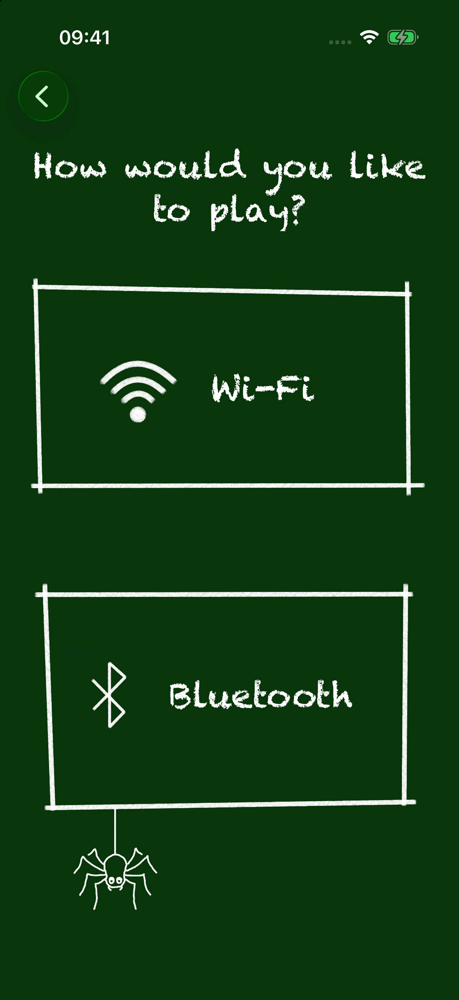
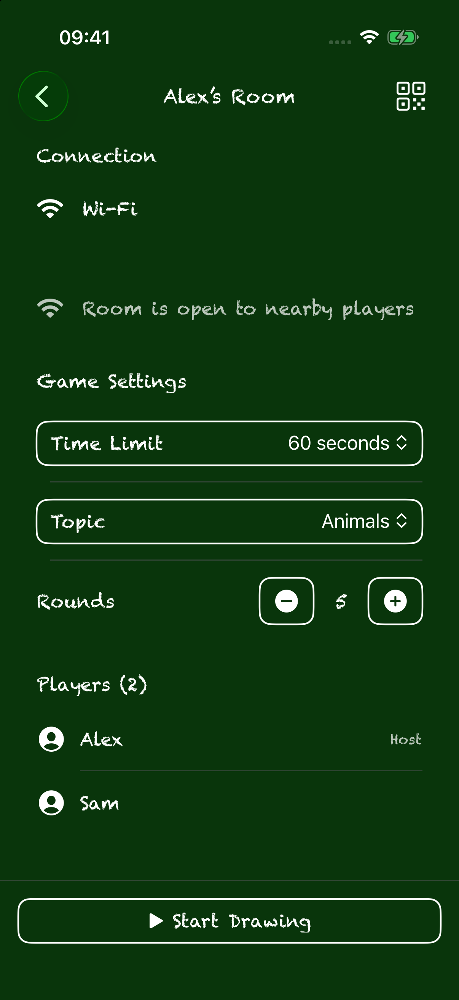
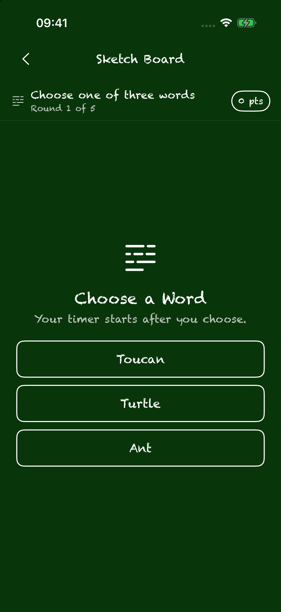
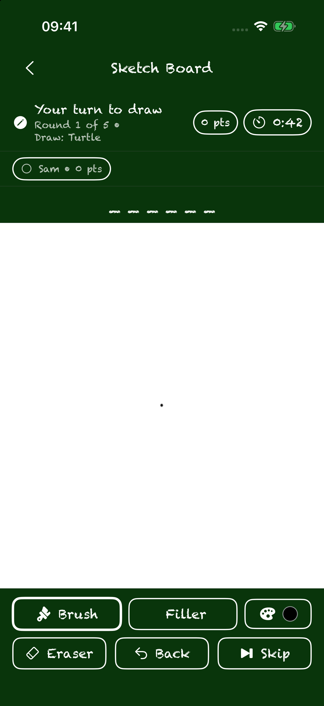
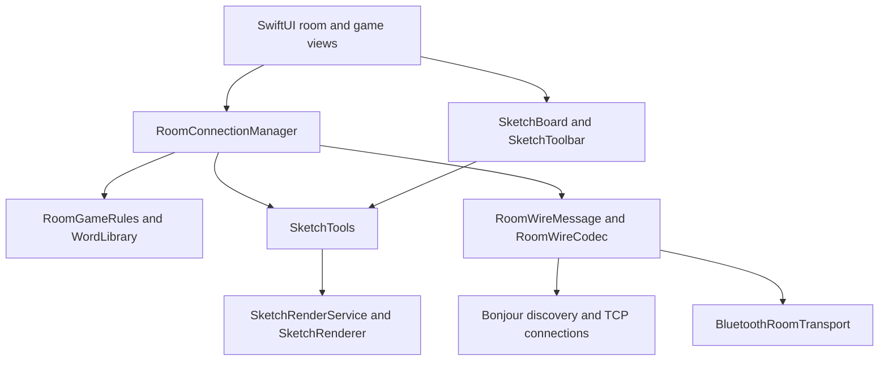

# Skrbl

Skrbl is a local multiplayer drawing and guessing game for iPhone and iPad. Its chalkboard-style interface lets one player create a room, invite nearby friends over Wi-Fi or Bluetooth, and take turns drawing while everyone else guesses the word. No account or hosted game server is required.

## Demo



The GIF was recorded from a live two-simulator Wi-Fi game and sped up to keep the walkthrough short.

## Screenshots

These are captures of the running app on iOS 26.2 simulators.

<table>
  <tr>
    <td align="center"><br>Home</td>
    <td align="center"><br>Connection mode</td>
    <td align="center"><br>Find a room</td>
  </tr>
  <tr>
    <td align="center"><br>Room lobby</td>
    <td align="center"><br>Choose a word</td>
    <td align="center"><br>Drawing round</td>
  </tr>
</table>

## Features

- **Nearby multiplayer:** Host or discover rooms over local Wi-Fi using Bonjour and TCP, or connect nearby devices over Bluetooth.
- **Room QR codes:** A host can show a QR code; a joining player can scan it to locate that room while using the matching connection mode.
- **Host-controlled game setup:** Choose a word topic, a 30–240 second turn limit, and the number of rounds before starting.
- **Turn-based drawing:** The drawer picks one of three words, then uses a brush, fill tool, color palette, undo, and clear controls on a shared canvas.
- **Live guessing and scoring:** Other players submit guesses during the timed turn. Hints reveal letters as time passes; correct guesses earn points based on speed and revealed hints. The drawer can earn points too.
- **Final rankings:** After the last round, players see their scores and placement.

## Requirements

- A Mac with Xcode and an iOS 26.2 or newer simulator runtime, or an iPhone/iPad running iOS 26.2 or newer.
- Two devices or simulators to play a multiplayer round. Wi-Fi play requires both players to be on the same local or peer-to-peer network. Bluetooth play is intended for nearby devices.
- A camera-equipped device to scan QR codes. You can also join from the discovered room list.

The project uses SwiftUI, Observation, Network.framework, CoreBluetooth, and bundled JSON word lists. It has no third-party package dependencies.

## Run the app

1. Open `Skrbl.xcodeproj` in Xcode.
2. Select the **Skrbl** scheme and an iOS 26.2 or newer destination.
3. If running on a physical device, configure a development team for code signing in the target settings.
4. Build and run. Accept the local network, Bluetooth, or camera permission prompts when using those features.

To play, launch the app on two devices. On one, select **Create room**, choose Wi-Fi or Bluetooth, and enter a name. On the other, select **Join room**, choose the same connection mode, enter a name, and select the discovered room or scan the host's QR code. The host sets the topic, timer, and rounds, then taps **Start Drawing**. Each drawer chooses a word before the timer begins; the other players guess until the turn ends. The game rotates drawers and eventually shows final rankings.

## Architecture

The app is a SwiftUI client with one observable room coordinator per create/join flow. The host is authoritative for the roster, settings, turn order, word choice, timer, guesses, and scores. Drawing commands and game events travel through the same wire-message layer on both transports.



| Area | Responsibility |
| --- | --- |
| `Skrbl/RoomViews` | Home-to-room flow, lobby settings, shared sketch session, and results UI. |
| `Skrbl/ConnectionConfigs/RoomConnectionManager.swift` | Observable room state and host/guest gameplay coordination. |
| `Skrbl/ConnectionConfigs/BluetoothRoomTransport.swift` | CoreBluetooth advertising, discovery, connection, and chunked data transfer. |
| `Skrbl/ConnectionConfigs/RoomWireMessage.swift` and `RoomWireCodec.swift` | Codable game messages and length-prefixed JSON packets. The codec rejects oversized or invalid drawing messages. |
| `Skrbl/SketchTools` | Normalized sketch points and commands, drawing history, canvas rendering, and batched stroke updates. |
| `Skrbl/WordLibrary` | Bundled JSON word lists and topic-based word selection. |
| `SkrblTests` | Tests for room rules, QR payloads, wire framing and validation, and sketch behavior. |

### A round in brief

1. The host advertises a room. Guests discover it and send a join message; the host distributes the roster and settings.
2. The host starts the game and assigns the first drawer. That player receives three word choices.
3. After the drawer picks a word, the host starts the timer and sends the initial hint. Sketch commands are relayed to the other players.
4. Guess messages go to the host, which checks answers, updates scores and hint state, and broadcasts the result.
5. The host advances to the next drawer or sends final rankings when the configured rounds are complete.

Wi-Fi rooms are advertised as `_sketra-room._tcp` Bonjour services. `RoomWireCodec` frames each JSON message with a four-byte length header and caps a message at 1 MiB. The same `RoomWireMessage` types carry lobby, drawing, guessing, and game-end events over Wi-Fi and Bluetooth.

## Tests

Run the **Skrbl** scheme's tests in Xcode with **Product → Test**, or use:

```sh
xcodebuild test \
  -project Skrbl.xcodeproj \
  -scheme Skrbl \
  -destination 'platform=iOS Simulator,name=iPhone 17 Pro,OS=26.2' \
  CODE_SIGNING_ALLOWED=NO
```

Choose a simulator name and OS version installed on your Mac if they differ from the example.

## Demo media

The screenshots and GIF live in `docs/media`. They were captured from the simulator, so they show the app's actual UI. To update a screenshot, run the app on a simulator and use `xcrun simctl io <device-udid> screenshot docs/media/<name>.png`. For a new GIF, record a short simulator video with `xcrun simctl io <device-udid> recordVideo --codec=h264 demo.mov`, stop recording with Control-C, and convert it with FFmpeg or another GIF encoder.
